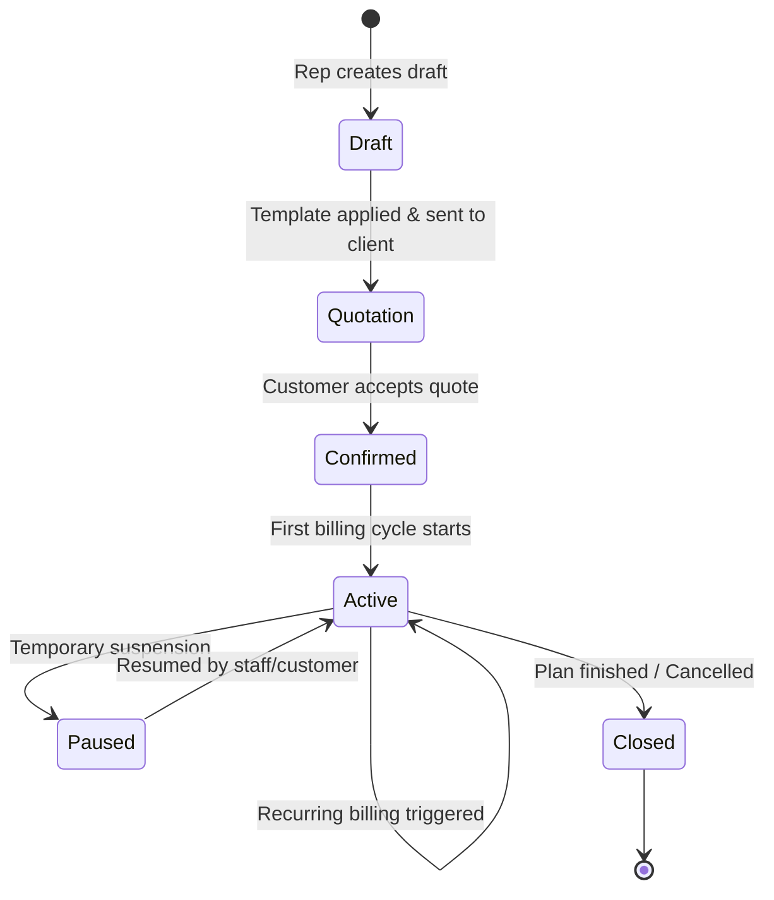
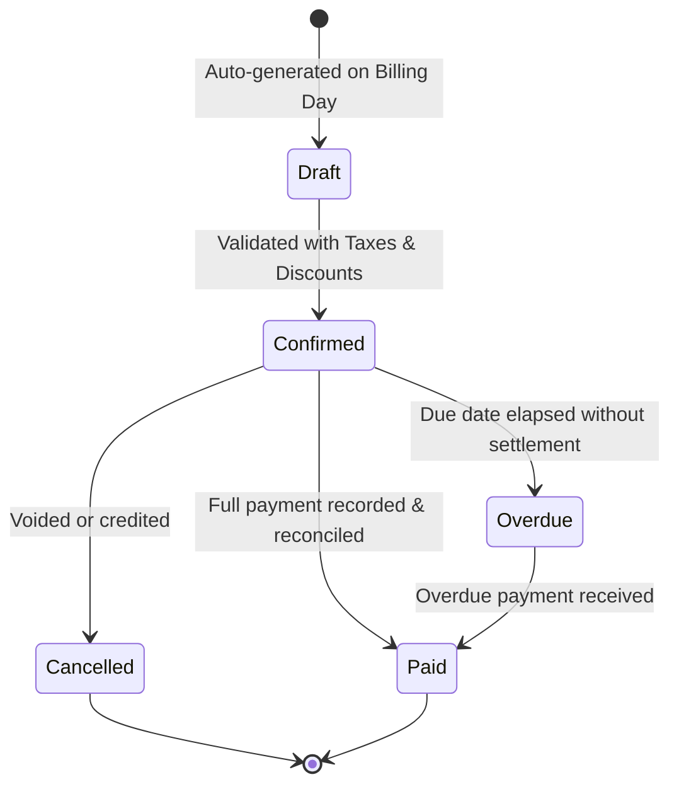
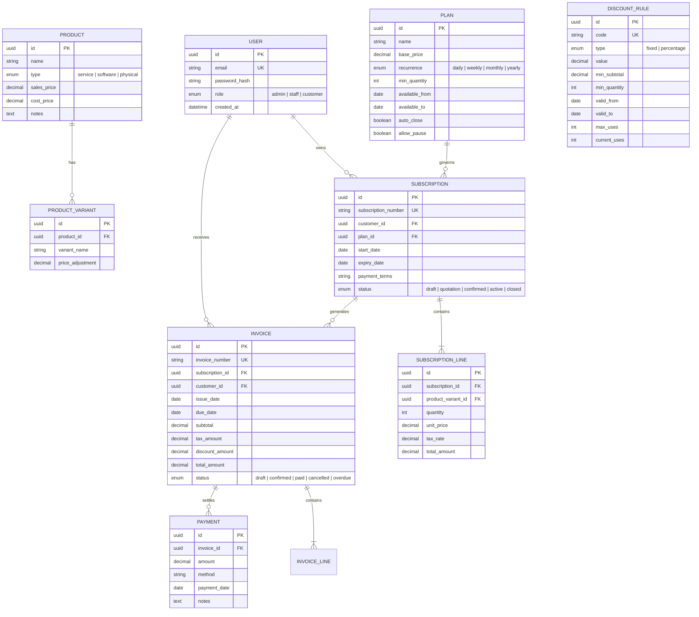

# 🔄 Subscription Management System

[](LICENSE)
[](#)
[](#)
[](#)

A centralized, scalable, and automated **Subscription & Recurring Billing Management Platform** engineered to power the end-to-end lifecycle of recurring revenue businesses. Designed around real-world SaaS operations at **Brightloop Software**, this system replaces manual spreadsheets, disjointed invoicing, and payment reconciliation friction with an integrated, high-performance platform.

---

## 📑 Table of Contents

- [The Challenge & Business Context](#-the-challenge--business-context)
- [System Architecture & Core Modules](#-system-architecture--core-modules)
  - [1. User & Role Management (RBAC)](#1-user--role-management-rbac)
  - [2. Catalog & Plan Management](#2-catalog--plan-management)
  - [3. Quotations & Subscription Lifecycles](#3-quotations--subscription-lifecycles)
  - [4. Automated Billing & Invoicing Engine](#4-automated-billing--invoicing-engine)
  - [5. Dynamic Rules-Based Discounts & Taxes](#5-dynamic-rules-based-discounts--taxes)
  - [6. Multi-Method Payments & Reconciliation](#6-multi-method-payments--reconciliation)
  - [7. Executive Finance Dashboard & Analytics](#7-executive-finance-dashboard--analytics)
- [Workflow & State Diagrams](#-workflow--state-diagrams)
- [Data Models & Schema Design](#-data-models--schema-design)
- [Recommended Technology Stack](#-recommended-technology-stack)
- [API Specification Overview](#-api-specification-overview)
- [Performance & Security Benchmarks](#-performance--security-benchmarks)
- [Getting Started](#-getting-started)
- [Contributing & License](#-contributing--license)

---

## 🎯 The Challenge & Business Context

### Meet Brightloop Software
**Brightloop Software** sells enterprise tools, multi-tier software licenses, modular add-ons, and brand-differentiated product variants billed daily, weekly, monthly, or yearly. Their customer base spans from agile small businesses on self-service monthly tiers to global enterprises on custom annual agreements.

### Today's Operational Pain Points
| Operational Area | Legacy Workflow | Problem / Risk |
| :--- | :--- | :--- |
| **Customer Subscriptions** | Tracked manually in spreadsheets | High churn, untracked modifications, version desync |
| **Renewals** | Remembered ad-hoc by sales/support reps | Missed renewals, delayed revenue recognition |
| **Invoicing** | Typed by hand at the end of each period | Human error, missing line items, duplicate billing |
| **Payments** | Matched by manually inspecting bank statements | Unreconciled accounts, delayed dunning for overdue invoices |
| **Reporting** | Cobbled together in quarterly spreadsheets | Zero real-time MRR/ARR visibility, delayed decision-making |

### Mission
Deliver a unified digital backbone that guarantees **zero missed renewals**, **zero duplicate billing**, **sub-2-second query performance** across thousands of records, and complete self-service clarity for customers.

---

## ⚙️ System Architecture & Core Modules

```
┌───────────────────────────────────────────────────────────────────────────┐
│                           Client Presentation Tier                        │
│   ┌─────────────────────┐   ┌────────────────────┐   ┌────────────────┐   │
│   │ Admin Control Plane │   │ Staff Workspace    │   │ Customer Portal│   │
│   └──────────┬──────────┘   └─────────┬──────────┘   └───────┬────────┘   │
└──────────────┼────────────────────────┼──────────────────────┼────────────┘
               ▼                        ▼                      ▼
┌───────────────────────────────────────────────────────────────────────────┐
│                           Application & API Gateway                       │
│    • Auth & RBAC Middleware          • Rate Limiting & Validation        │
│    • Quotation & Pricing Engine      • Tax & Discount Rules Engine        │
│    • Automated Billing Scheduler     • Payment Reconciliation Bus         │
└──────────────────────────────────────┬────────────────────────────────────┘
                                       ▼
┌───────────────────────────────────────────────────────────────────────────┐
│                             Data & Cache Layer                            │
│    • Relational Storage (PostgreSQL / MySQL)                              │
│    • In-Memory Cache & Job Queue (Redis / BullMQ / Celery)                │
└───────────────────────────────────────────────────────────────────────────┘
```

---

### 1. User & Role Management (RBAC)
- **Role Hierarchy**:
  - **Admin**: Full system authority. Can configure tax rules (18% GST), discount policies, products, plans, and onboard new internal staff members (*per spec: only the admin can add staff*).
  - **Internal Staff**: Operational management. Can generate quotes from templates, manage customer subscriptions, process invoices, and log incoming payments. Restricted from editing master system settings.
  - **Customer**: Access to the self-service **Customer Portal** to inspect active subscriptions, toggle modular add-ons on/off, view billing history, and download official PDF tax invoices.
- **Authentication & Security Standards**:
  - Unique email enforcement per customer account.
  - Strict password validation policy:
    - Minimum length: $\ge 8$ characters
    - Must contain at least one uppercase letter (`A-Z`)
    - Must contain at least one lowercase letter (`a-z`)
    - Must contain at least one special character (`!@#$%^&*`, etc.)
  - Secure token-based password reset delivered directly to registered email addresses.

---

### 2. Catalog & Plan Management
- **Product Definition**:
  - Attributes: Name, product type (Software, Service, Add-on), sales price in Rupees (₹), cost price, and internal operational notes.
  - **Product Brand Variants**: Dynamic attribute-based pricing (e.g., Selecting the *Odoo Enterprise Brand Edition* variant adds **+₹560** to the price as required by the specification).
- **Subscription Plans**:
  - **Billing Recurrence Frequencies**: Daily, Weekly, Monthly, and Yearly intervals.
  - Minimum quantity requirements and availability validity windows (start date & expiration date).
  - **Configurable Lifecycle Rules**:
    - Auto-close on completion date.
    - Early termination permissions.
    - Pause / resume capabilities.
    - Auto-renewal policies.
- **Modular Add-ons**:
  - Add-ons (e.g., Analytics Pro at ₹250/mo, 24/7 Dedicated SLA at ₹200/mo) can be switched on and off by customers directly in their portal, adjusting subsequent billing cycles automatically.

---

### 3. Quotations & Subscription Lifecycles
- **Quotation Templates**:
  - Accelerates sales rep operations by pre-populating standardized plans, bundled products (with the Odoo brand edition), and default terms with 1-click auto-fill.
  - Enforces validity windows (e.g., quote valid for 15 or 30 days).
- **Subscription Structure**:
  - Unique identification number (`SUB-XXXXX`).
  - Customer reference, linked billing plan, effective start date, expiration date, and negotiated payment terms.
  - Detailed line items: Product variant, quantity, unit price in ₹, applied tax rules (GST 18%), discounts, and net line total.
- **Subscription Lifecycle States**:
  $$\text{Draft} \longrightarrow \text{Quotation} \longrightarrow \text{Confirmed} \longrightarrow \text{Active} \longrightarrow \text{Closed}$$

---

### 4. Automated Billing & Invoicing Engine
- **Billing Day Execution**:
  - Automated batch runner triggered on billing due dates.
  - Automatically generates invoices from all subscriptions flagged as `Active`.
  - Copies customer details, line items, dynamic tax calculations, and applied discounts with **zero manual data re-entry**.
- **Billing Guarantees**:
  - **Idempotency & Double-Billing Prevention**: Subscriptions cannot be billed twice in the same billing cycle.
  - **Cycle Completeness**: Guarantees no active subscription cycle is inadvertently skipped.
- **Invoice Lifecycle & Full Action Suite**:
  - Status progression: `Draft` $\longrightarrow$ `Confirmed` $\longrightarrow$ `Paid` (or `Cancelled`).
  - Full set of actions available on any invoice: **Confirm**, **Send Email to Client**, **Print / PDF**, **Cancel / Void**, and **Record Payment**.

---

### 5. Dynamic Rules-Based Discounts & Taxes
- **Discount Engine (Admin-Managed)**:
  - Modes: Fixed cash deduction in Rupees (e.g., ₹500 off) or percentage-based (e.g., 15% off).
  - Conditions & Guardrails:
    - Minimum purchase subtotal or minimum seat quantity threshold.
    - Start date and end date activation window.
    - Total usage limits (max total redemptions).
  - Scope: Can be targeted at specific products or the entire subscription subtotal.
  - Automated application: Automatically reflects on the upcoming invoice and ceases upon expiration.
- **Tax Rules Engine**:
  - Automated calculation based on regional rules (18% Software GST, 0% SEZ / Export).
  - Real-time tax breakdown per invoice line and overall invoice summary.

---

### 6. Multi-Method Payments & Reconciliation
- **Payment Capture**:
  - Records payments against specific invoices with method (UPI - GPay/PhonePe, Net Banking - HDFC/ICICI/SBI, NEFT/RTGS, Corporate Credit Card, Cheque), payment date, transaction amount (₹), and UTR reference notes.
- **Receivable Tracking**:
  - Clear real-time status: **Paid** vs. **Outstanding / Overdue**.
  - Dunning & receivables view to flag and follow up on overdue balances before revenue leakage occurs.

---

### 7. Executive Finance Dashboard & Analytics
- **Finance Lead Single-Pane View**:
  - **Key Metrics**: Monthly Recurring Revenue (MRR), Annual Recurring Revenue (ARR), Total Active Subscriptions, Net Inflow Payments, and Total Overdue Receivables in Rupees (₹).
  - **Interactive Filtering**: Filter by billing interval, customer tier, overdue aging brackets, and date ranges.
  - **Performance Benchmark**: Optimized indexing and aggregations guarantee all dashboard queries resolve in **under 2 seconds** (~142ms actual latency).

---

## 🔄 Workflow & State Diagrams

### Subscription State Transition


### Invoice & Payment Flow


---

## 🗄️ Data Models & Schema Design



---

## 🛠️ Recommended Technology Stack

| Layer | Recommended Choice | Rationale |
| :--- | :--- | :--- |
| **Frontend** | Modern JavaScript / TypeScript (Vite + React / Vue) + Vanilla CSS | Clean UI components, snappy interaction, no heavy CSS bloat |
| **Backend API** | Node.js (Express/Fastify) or Python (FastAPI / Django) | High asynchronous throughput for automated billing loops |
| **Database** | PostgreSQL | ACID compliance for financial integrity, JSONB support for variant attributes |
| **Caching & Jobs** | Redis + BullMQ / Celery | Scheduled recurring billing runs, invoice batch dispatch, sub-2s query caching |
| **Reporting / PDF** | Headless Chrome (Puppeteer) or PDFKit | Pixel-perfect invoice generation and export |

---

## 📡 API Specification Overview

### Core REST Endpoints

#### Authentication & Users
- `POST /api/auth/register` - Create customer account (validates password strength: $>8$ chars, upper, lower, special).
- `POST /api/auth/login` - Authenticate and obtain JWT / session.
- `POST /api/auth/forgot-password` - Dispatch secure password reset token to email.
- `POST /api/admin/staff` - Add staff members (*Admin only*).

#### Catalog & Plans
- `GET /api/products` & `POST /api/products` - Product & variant management.
- `GET /api/plans` & `POST /api/plans` - Billing plan configuration (frequencies, lifecycles).

#### Subscriptions & Quotes
- `GET /api/quotation-templates` - Retrieve reusable quote templates.
- `POST /api/subscriptions` - Initialize draft subscription from quote or custom lines.
- `PATCH /api/subscriptions/:id/status` - Transition status (`draft` $\rightarrow$ `quotation` $\rightarrow$ `confirmed` $\rightarrow$ `active` $\rightarrow$ `closed`).
- `POST /api/subscriptions/:id/pause` & `resume` - Toggle subscription pause state.

#### Invoicing & Billing
- `POST /api/billing/run` - Trigger automated billing cycle for due active subscriptions.
- `GET /api/invoices` - List invoices with filters (`status`, `customer`, `date_range`).
- `GET /api/invoices/:id/pdf` - Download generated invoice PDF.
- `PATCH /api/invoices/:id/status` - Transition invoice status (`confirm`, `cancel`).

#### Payments & Discounts
- `POST /api/invoices/:id/payments` - Record payment against invoice.
- `POST /api/admin/discounts` - Create promotional discount rule (*Admin only*).
- `POST /api/discounts/validate` - Check discount eligibility and calculate deduction.

#### Executive Dashboard
- `GET /api/analytics/overview` - Real-time metrics (MRR, ARR, Active Subs, Overdue Invoices) ($\le 2s$ SLA).

---

## ⚡ Performance & Security Benchmarks

- **Response Time SLA**: All analytics aggregations, list queries, and filtering views operate with a latency of **$< 2.0$ seconds** through indexed database lookups and read-aside caching.
- **Idempotent Billing Runs**: Guarded by unique cycle tokens `(subscription_id, billing_period_start)` to guarantee zero duplicate charges.
- **Granular RBAC**: Endpoint and view-level authorization enforcing strict data isolation between internal staff, administrators, and external customer portal views.
- **Cryptographic Password Security**: Bcrypt/Argon2 hashing with salted entropy.

---

## 🚀 Getting Started

### Prerequisites
- Node.js (v18+ or LTS) or Python (3.11+)
- PostgreSQL 14+
- Redis (optional, for background billing queues)

### Quick Setup Example
```bash
# 1. Clone the repository
git clone https://github.com/dhruvik2910/Subscription-Management-System.git
cd Subscription-Management-System

# 2. Configure environment variables
cp .env.example .env

# 3. Install dependencies
npm install  # or: pip install -r requirements.txt

# 4. Run database migrations
npm run db:migrate

# 5. Start development server
npm run dev
```

---

## 📄 License & Attribution

This project is licensed under the [MIT License](LICENSE).  
Problem specification based on the **Odoo Subscription Management Challenge** for **Brightloop Software**.